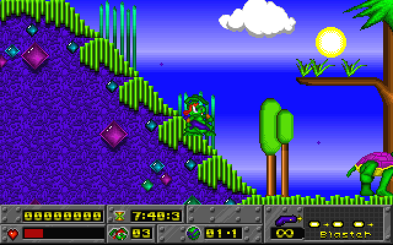

# Jazz Jackrabbit — Static Recompilation

Static recompilation of **Jazz Jackrabbit** (Epic MegaGames, 1994; the CD
version, v1.2) from its shipping DOS executable to C, built as a native
Windows program: no emulator, no DOSBox. The game is `FILE0001.EXE`
(`JAZZ.EXE` only starts it), a 16-bit protected-mode Borland Pascal 7 program
for Borland's DOS extender, RTM, in the NE format Windows 3.1 uses. pcrecomp's
NE front end lifts its 10 code segments to C, its Win16 host answers the
KERNEL imports, and `runtime/` is the DOS machine underneath: DPMI, DOS, the
BIOS, the VGA in Mode X, the timer, the keyboard, and a small interpreter for
the sprites the game compiles to x86 at run time.

Built on the [pcrecomp](https://github.com/sp00nznet/pcrecomp) toolchain, on
its branch **`pcrecomp-ne-jazz`** (not yet in `main`), in the layout of the
[Space Bucks recomp](https://github.com/sp00nznet/spacebucks-recomp).

## Getting Started

You need **your own Jazz Jackrabbit CD** (or a mounted image, or a copy of
its files). Nothing from the game is in this repository or downloaded for
you; everything is built on your machine from your copy. There is no
installer release yet.

### The setup script

1. Download this repository (the green **Code** button, then **Download ZIP**)
   and unzip it somewhere with 1 GB free.
2. Put the CD in (or mount its image).
3. Windows: double-click **`Setup.cmd`**.
4. Play with the **`Jazz Jackrabbit`** shortcut in that folder. The first run
   opens the game's options screen; pick DONE.

The script checks for Python 3, Git and MSYS2's MinGW-w64 gcc, CMake and
Ninja, and **asks** before installing them, saying what and how big. It finds
`FILE0001.EXE` on any drive or asks where it is (`Setup.cmd -GameDir E:\`;
`-Yes` answers yes to everything), copies the CD into `game\`, sets up "no
sound card", clones pcrecomp's `pcrecomp-ne-jazz` branch beside this folder
(as `pcrecomp-pcrecomp-ne-jazz`, unless your `..\pcrecomp` is already on it),
lifts and builds. A rerun skips finished steps (`-Force` redoes the lift); if
it stops, it says why in one sentence and the details are in `setup.log`.
Building by hand is in **[docs/building.md](docs/building.md)**.

Linux and macOS: not yet. The host is a Win32 program built with MinGW, and
`./setup.sh` says so and exits.

## Status

**v0.2.0, early alpha: Diamondus 1 plays.** Jazz runs, jumps, collects gems
and gets hurt.

| Area | State |
|---|---|
| Version recompiled | Jazz Jackrabbit CD (USA), `FILE0001.EXE` (234,752 bytes, 1994-10-17) |
| Lift (`tools/relift.py`) | 7,142 functions, 0 unresolved calls, from pcrecomp's own code map: no IDA (six entries the map misses are seeded in `tools/entry_seeds.json`) |
| DPMI, RTM's heap, the CRT unit, the BIOS data area | working |
| Intro cutscene, title, main menu, options, episodes, "Now approaching" | working |
| Keyboard and the 70 Hz timer, through the game's own INT 9 and INT 8 handlers | working |
| A level: status panel, playfield, scrolling, Jazz and the enemies | working; some background areas draw black |
| Sound and music | off: the drivers are machine code loaded at run time |
| Headless runs | `JAZZ_HEADLESS=1` with scripted keys and screenshots ([docs/testing.md](docs/testing.md)); no `--headless --record` yet |
| Conformance harness | not yet |

[docs/lifting.md](docs/lifting.md) is the log of each wall and its fix, and
[ROADMAP.md](ROADMAP.md) what comes next.

## Screenshots

Real output of the recompiled game:

| | |
|---|---|
|  |  |
|  |  |
|  |  |

## Documentation

- [docs/building.md](docs/building.md): building by hand, the toolkit branch, the usual trip-ups
- [docs/testing.md](docs/testing.md): headless runs, scripted keys and screenshots
- [docs/lifting.md](docs/lifting.md): every wall so far and its fix
- [ROADMAP.md](ROADMAP.md), [CHANGELOG.md](CHANGELOG.md), [CONTRIBUTING.md](CONTRIBUTING.md)

## Contributors

See **[CONTRIBUTORS.md](CONTRIBUTORS.md)** for who did what.

## License

MIT for this repository's own code ([LICENSE](LICENSE)). Jazz Jackrabbit is
© Epic MegaGames; none of its files, and nothing generated from them, is in
this repository ([NOTICE.md](NOTICE.md)).
