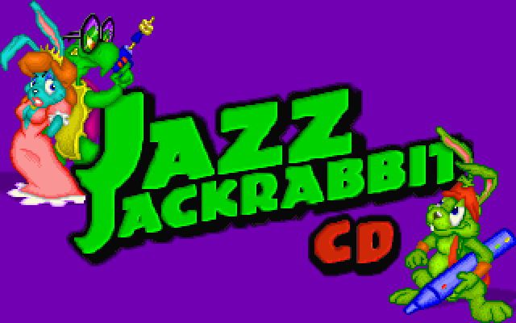
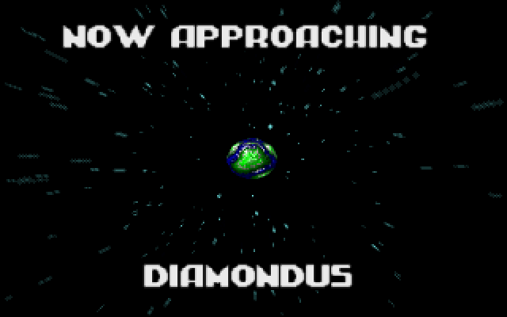

# Jazz Jackrabbit: Static Recompilation



## What it is

A static recompilation of **Jazz Jackrabbit** (Epic MegaGames, 1994; the CD
version, v1.2) from its shipping DOS executable to C, built as a native
Windows program. No emulator, no DOSBox.

The game is `FILE0001.EXE` (`JAZZ.EXE` only starts it): a 16-bit
protected-mode program written in Borland Pascal 7 for Borland's DOS
extender, RTM, and an NE executable like a Windows 3.1 program.
[pcrecomp](https://github.com/sp00nznet/pcrecomp)'s NE front end lifts its 10
code segments (200 KB, 6,754 functions) to C. pcrecomp's Win16 host loads it
and answers its KERNEL imports, since RTM looks like Windows to the program.
`runtime/` is the DOS machine underneath: DPMI, DOS, the BIOS, the VGA in
Mode X, the timer and the keyboard.

Built on the [pcrecomp](https://github.com/sp00nznet/pcrecomp) toolchain and
following its shared house style (layout, CLI, conformance harness, headless
mode), like the other recomps there. The layout is the
[Space Bucks recomp](https://github.com/sp00nznet/spacebucks-recomp)'s.

**Generated source is not distributed.** You supply your own copy of the game,
and the lifted C is generated on your machine into `work/` (gitignored).
Nothing from the game is in this repository.

## Status: **v0.1.0, early alpha. It reaches the levels; the playfield draws wrong.**

| Area | State |
|---|---|
| Version recompiled | Jazz Jackrabbit CD (USA), `FILE0001.EXE` (234,752 bytes, 1994-10-17) |
| Lift (`tools/relift.py`) | 7,142 functions, 0 unresolved calls, from pcrecomp's own code map: no IDA |
| DPMI, RTM's heap, the CRT unit, the BIOS data area | ✅ |
| Intro cutscene, title, main menu, options, episodes, "Now approaching" | ✅ |
| Keyboard, through the game's own INT 9 handler | ✅ |
| The 70 Hz timer, through the game's own INT 8 handler | ✅ |
| A level: status panel, timer, score | ✅ |
| A level: the playfield | ❌ the camera settles mid-page and most tiles are missing |
| Sound and music | ❌ off: the drivers are machine code loaded at run time |
| Headless runs | `JAZZ_HEADLESS=1` with scripted keys and screenshots; no `--headless --record` yet |
| Conformance harness | not yet ([ROADMAP](ROADMAP.md)) |
| `Setup.cmd` | ✅ tested from a clean clone with the IDA lift; the IDA-free setup is not re-run from a clean clone yet |
| Installer (recomp-launcher) | `launcher/launcher.json` and a manual-run workflow; no installer has been built yet |
| Toolkit | pcrecomp's `pcrecomp-ne-nativemap` branch (one branch for the Win16 recomps), not merged into `main` yet |

## Screenshots

Real output of the recompiled game:

| | |
|---|---|
|  |  |
|  |  |
|  | |

## Getting Started

You need **your own Jazz Jackrabbit CD** (or a mounted image, or a copy of
its files). Nothing is downloaded from the game, and no commercial tool is
needed.

### Quick start: Setup.cmd

1. Download this repository (the green **Code** button, then **Download ZIP**)
   and unzip it.
2. Put the CD in (or mount its image).
3. Double-click **`Setup.cmd`**.

It checks for Python 3, Git and
MSYS2's MinGW-w64 gcc, CMake and Ninja, and **asks** before installing what
it can (Python, Git and MSYS2 with winget, the compilers with pacman), saying
what and how big. It finds `FILE0001.EXE` on any drive, or asks where it is
(`Setup.cmd -GameDir E:\` skips the question, `-Yes` answers yes to every
install). Then it copies the CD into `game\`, sets up "no sound card", clones
pcrecomp's `pcrecomp-ne-nativemap` branch beside this folder (as `pcrecomp-pcrecomp-ne-nativemap`,
unless your `..\pcrecomp` is already on it), lifts,
builds, and leaves a **`Jazz Jackrabbit`** shortcut in this folder. A rerun
skips finished steps (`-Force` redoes the lift). If it stops, it says why in
one sentence, and the details are in `setup.log`.

### Step by step

Prerequisites: Windows 10/11, Python 3 (`py -3 --version`), Git, and
[MSYS2](https://www.msys2.org/) with `mingw-w64-x86_64-gcc`,
`mingw-w64-x86_64-cmake` and `mingw-w64-x86_64-ninja`
(`pacman -S mingw-w64-x86_64-gcc mingw-w64-x86_64-cmake mingw-w64-x86_64-ninja`),
with `C:\msys64\mingw64\bin` on `PATH`.

1. **The toolkit**, beside this folder, on its `pcrecomp-ne-nativemap` branch:
   ```
   git clone --branch pcrecomp-ne-nativemap https://github.com/sp00nznet/pcrecomp ..\pcrecomp-pcrecomp-ne-nativemap
   set PCRECOMP_DIR=%CD%\..\pcrecomp-pcrecomp-ne-nativemap
   ```
   Without `PCRECOMP_DIR`, `tools\relift.py` and CMake look for `..\pcrecomp`.
2. **Your game files**: copy everything from the CD's root into `game\`.
3. **No sound card**, as the game's own SETUP would set it up:
   ```
   > py -3 tools\make_soundcrd.py
   wrote SOUNDCRD.INF and NOSOUND.MUS (no sound card)
   ```
4. **Lift** into `work\` (pcrecomp builds the code map itself):
   ```
   > py -3 tools\relift.py
     FILE0001: native code map, 644 functions, 71757 heads
   Wrote work\src\_unresolved_stubs.c: 0 unresolved stubs (7142 lifted functions, 6930 distinct call targets, 0.00% unresolved)
   ...
   image: 391648 bytes (0.37 MB) -> work\mem_image.bin
   ```
5. **Build**:
   ```
   cmake -S . -B build -G Ninja -DCMAKE_C_COMPILER=C:/msys64/mingw64/bin/gcc.exe -DPCRECOMP_DIR=%PCRECOMP_DIR%
   cmake --build build
   ```
   Expected: `Linking C executable jazz.exe`.
6. **Play**: `build\jazz.exe`. The first run opens the game's options
   screen; pick DONE.

The usual trip-ups: `python` opening the Microsoft Store (that is Windows'
alias placeholder; use `py -3`); a freshly installed tool not being on `PATH`
until you open a new window; and a `..\pcrecomp` on `main`, which
lacks the DOS-extended Win16 host and the native code map.

## Usage

`build\jazz.exe` plays in a window, with the keyboard. The paths to `game\`
and `work\mem_image.bin` are compiled in, so it runs from this checkout.

Test runs are driven by environment variables:

```
set JAZZ_HEADLESS=1
set JAZZ_SECS=25
set JAZZ_SHOT=8:C:\tmp\intro.bmp,20:C:\tmp\title.bmp
build\jazz.exe
```

| Variable | |
|---|---|
| `JAZZ_HEADLESS=1` | no window |
| `JAZZ_SECS=N` | exit after N seconds |
| `JAZZ_SHOT="S:file.bmp,..."` | the screen at S seconds; paths must be absolute, because the game runs in `game\` |
| `JAZZ_KEYS="S:key,..."` | scripted keys at S seconds (`enter space esc up down left right ctrl alt y n f1..f10 1..9 a..z`) |
| `JAZZ_LOG=1` | every DPMI and DOS call |

## Building from source

Steps 1 to 5 above; `Setup.cmd` runs the same commands. What this game needed
from the toolkit and the runtime, in the order it turned up, is
[docs/lifting.md](docs/lifting.md).

## Credits

The VGA comes from the Blake Stone host in
[marioismissing-dos](https://github.com/sp00nznet/marioismissing-dos); the
layout from the [Space Bucks recomp](https://github.com/sp00nznet/spacebucks-recomp).
Both run on [pcrecomp](https://github.com/sp00nznet/pcrecomp). See [NOTICE](NOTICE).

## License

MIT for the code in this repository; see [LICENSE](LICENSE). Jazz Jackrabbit
is (c) Epic MegaGames and is not included.
