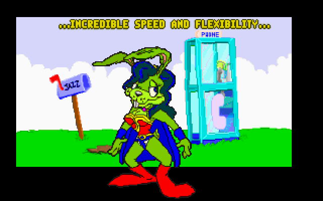
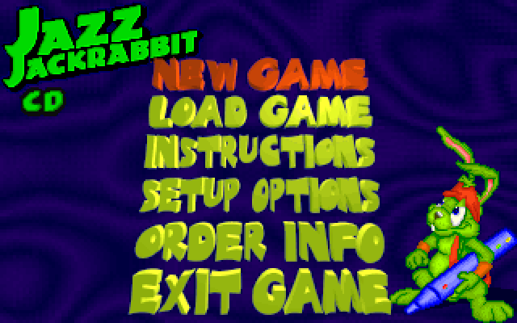
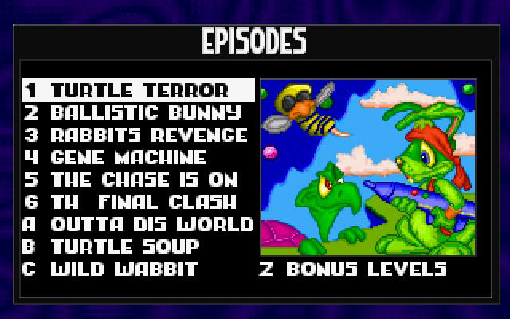
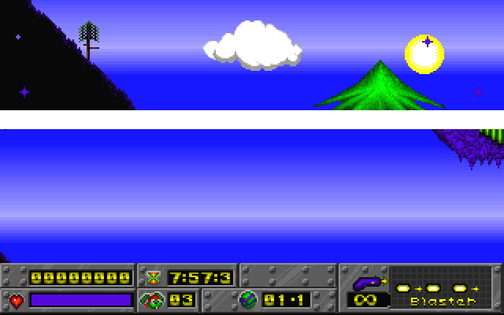

<div align="center">

# Jazz Jackrabbit, recompiled

**Jazz Jackrabbit** (Epic MegaGames, 1994; the CD version, v1.2), taken apart
from its shipping DOS executable and rebuilt as a native Windows program.
No emulator, no DOSBox.


</div>

## What it is

A static recompilation of `FILE0001.EXE`, the game itself (`JAZZ.EXE` only
starts it). It is a 16-bit protected-mode program written in Borland Pascal 7
for Borland's DOS extender, RTM, and it is an NE executable like a Windows 3.1
program. [pcrecomp](https://github.com/sp00nznet/pcrecomp)'s NE front end lifts
its 10 code segments (200 KB, 6,754 functions) to C. pcrecomp's Win16 host
loads it and answers its KERNEL imports, since RTM looks like Windows to the
program. `runtime/` is the DOS machine underneath: DPMI, DOS, the BIOS, the
VGA in Mode X, the timer and the keyboard.

**Generated source is not distributed.** You supply your own copy of the game,
and the lifted C is generated on your machine. Nothing from the game is in this
repository.

## Status: early. It reaches the levels; the playfield draws wrong.

| | |
|---|---|
| Version recompiled | Jazz Jackrabbit CD (USA), `FILE0001.EXE` (234,752 bytes, 1994-10-17) |
| Lift | 6,754 functions, 0 unresolved calls, with an IDA code map |
| DPMI, RTM's heap, the CRT unit, the BIOS data area | ✅ |
| Intro cutscene, title, main menu, options, episodes, "Now approaching" | ✅ |
| Keyboard, through the game's own INT 9 handler | ✅ |
| The 70 Hz timer, through the game's own INT 8 handler | ✅ |
| A level: status panel, timer, score | ✅ |
| A level: the playfield | ❌ the camera settles mid-page and most tiles are missing |
| Sound and music | off: the drivers are machine code loaded at run time |
| Setup script, launcher, netlab | not yet |

| | |
|---|---|
|  |  |
|  |  |

## Getting started

You need the CD, Python 3 with `capstone`, CMake, Ninja, MSYS2's MinGW-w64 gcc,
IDA 9 (its `idalib`, for the code map), and a checkout of
[pcrecomp](https://github.com/sp00nznet/pcrecomp) next to this one, on its
`win16-dos` branch until that is merged.

1. Copy everything from the CD's root into `game\`.
2. Set up "no sound card", as the game's own SETUP would:
   `py -3 tools/make_soundcrd.py`.
3. Lift it: `py -3 tools/relift.py --ida` (writes `work/`).
4. Build it:
   ```
   cmake -S . -B build -G Ninja -DCMAKE_C_COMPILER=C:/msys64/mingw64/bin/gcc.exe
   cmake --build build
   ```
5. Run it: `build\jazz.exe`. The first run opens the game's options screen;
   pick DONE.

Test runs: `JAZZ_HEADLESS=1`, `JAZZ_SECS=N`, `JAZZ_SHOT="S:file.bmp,..."`,
`JAZZ_KEYS="S:key,..."`, `JAZZ_LOG=1` (every DPMI and DOS call). Screenshot
paths must be absolute, because the game runs in `game\`.

## How it works

[docs/lifting.md](docs/lifting.md) is what this game needed, in the order it
turned up.

## Credits

The VGA comes from the Blake Stone host in
[marioismissing-dos](https://github.com/sp00nznet/marioismissing-dos); the
layout from the [Space Bucks recomp](https://github.com/sp00nznet/spacebucks-recomp).
Both run on [pcrecomp](https://github.com/sp00nznet/pcrecomp). See [NOTICE](NOTICE).

## License

MIT for the code in this repository; see [LICENSE](LICENSE). Jazz Jackrabbit
is (c) Epic MegaGames and is not included.
